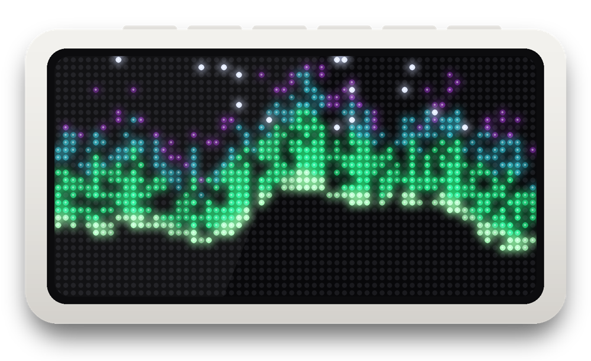
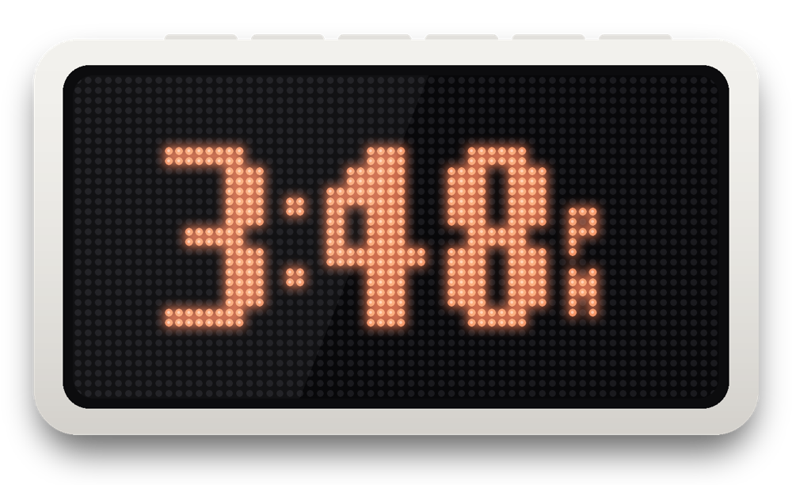

# pixelrise-skymood

Local, cloud-free control of the **Dekala PixelRise** pixel-art alarm clock from a Mac:

- **Sky moods.** The clock's built-in animations follow live NOAA space weather and the sun: a calm night
  scene after dusk, an aurora scene when Kp climbs, a red "storm" scene when the aurora could be overhead.
- **Claude scene.** While any Claude Code session on the Mac is working, the clock shows an orange
  "thinking" scene. It goes back to the sky mood a minute after the last session finishes.
- Everything runs over the home Wi-Fi with Tuya's local protocol. No cloud round-trip, and no vendor app needed once it's set up.

<p> </p>

<sub>Simulated displays.</sub>

Built in one afternoon (2026-10-21) with [Claude Code](https://claude.com/claude-code), from "what's inside this clock?" to
a running service. Unofficial: not affiliated with Dekala or Tuya.

## What the clock can and can't do

The PixelRise is a white-label **Tuya** device: a Tuya Wi-Fi module next to a separate chip that drives the LED matrix.
Watching the device while driving its app showed:

- The "Animation Template" playlist is a list of **built-in animation IDs** (about 30 ship on the clock), each with a
  play time and a colour (8 preset swatches).
- **No pixel data goes over Wi-Fi**, so stock firmware can't show your own art or text. This project changes
  *which* built-ins play, plus brightness and alarms.
- Full byte-level notes are in [PROTOCOL.md](PROTOCOL.md).

## Moods

| Mood | When (defaults, all in `config.local.json`) | Clock |
|---|---|---|
| day | sun above −6° | your own playlist (anything you set in the app during the day becomes the day playlist) |
| night | 8 PM–7 AM (`night_hours`; without it, dusk to dawn), quiet sky | blue clock + rain, dimmed |
| aurora_watch | dark (sun < −12°) and Kp ≥ 4, or Bz ≤ −10 nT, or OVATION ≥ 5 % within 10° poleward, or tonight's forecast ≥ 6⅓ | orange clock + wave + comet |
| aurora_storm | dark and Kp ≥ 6⅓, or OVATION ≥ 20 % | red clock + wave + galaxy + particles + swirl |
| claude | any Claude Code session busy (+60 s linger) | orange clock (40 s) + sparkle burst (10 s), so it reads at a glance (at the current mood's brightness; aurora moods win) |

During `night_hours` the backlight is always dim, including for the aurora and Claude scenes.

**Behaviour:**
- Moods escalate immediately and step down only after 30 minutes.
- A playlist change made in the app at night pauses automation for 3 hours.
- Optional `aurora_alarm` (off by default) rings Alarm 1 two minutes after a storm starts (once per night), then
  restores your alarm.

**Data**, all public NOAA SWPC feeds:
- 1-minute estimated Kp
- 3-day Kp forecast
- solar-wind Bz
- OVATION aurora probability map

The sun's altitude is computed locally.

## Setup

1. **Pair the clock in Smart Life** (or Tuya Smart) instead of the Dekala app. Tuya's tools only hand out local keys for those accounts.
   - Pairing mode: hold the top-right **WiFi** button for 3 s.
   - Force-quit the Dekala app first; if it's left on its Add Device screen it grabs the Bluetooth connection.
   - Smart Life needs a "home" created before it can add devices.
2. Install:
   ```
   python3 -m venv .venv && .venv/bin/pip install -r requirements.txt
   ```
3. **Get the local key** (read-only cloud call; no Tuya developer account):
   ```
   .venv/bin/python -I tools/get_keys.py <USER_CODE>
   ```
   - The User Code is in Smart Life → Me → ⚙ → Account and Security → User Code.
   - Scan the QR it opens with Smart Life (+ → Scan) and confirm.
   - Keys land in git-ignored `secrets/`.
4. **Find the clock and read it:**
   - `.venv/bin/python -I tools/recon.py ports <ip>` finds devices answering on TCP 6668.
   - `.venv/bin/python -I tools/dump_dps.py PixelRise <ip>` reads the clock's state (read-only).
5. **Configure and try it:**
   - `cp config.example.json config.local.json`, then set `lat`, `lon` and `clock_ip`.
   - `.venv/bin/python -I skymood.py status` shows the sky and the chosen mood, without touching the clock.
   - `.venv/bin/python -I skymood.py preview aurora_storm 45` shows a mood for 45 s, then restores.
6. **Run it at login:** fill in `launchd/com.example.skymood.plist`, copy it to `~/Library/LaunchAgents/`, then
   `launchctl bootstrap gui/$(id -u) ~/Library/LaunchAgents/com.example.skymood.plist`.
7. **Claude scene (optional):** merge `hooks/claude-code-hooks.json` into `~/.claude/settings.json`.
   - The async hooks write `busy` / `idle` per session into `~/Library/Application Support/skymood/claude-busy/`.
   - The daemon watches that folder.

## Tools

| File | What it does |
|---|---|
| `skymood.py` | the controller: `status`, `once [--dry-run]`, `run [--dry-run]`, `preview MOOD [SECONDS]` |
| `tools/get_keys.py` | Smart Life QR login via Tuya's device-sharing SDK (the client registration Home Assistant uses); saves local keys and DP specs |
| `tools/dump_dps.py` | read-only local status read over TCP 6668 (tries protocol 3.5, 3.4, 3.3) |
| `tools/watch_local.py` | read-only listener: prints every DP the clock reports while you change things in the app |
| `tools/watch_cloud.py` | same through Tuya's message queue (it never delivered for this clock; the local one works) |
| `tools/recon.py` | read-only LAN recon: TCP connect check, SSDP query, passive listen on Tuya discovery ports |

## Caveats

- Moving the clock from the Dekala app to Smart Life re-pairs it. It's reversible: remove it there and add it back in Dekala.
- Writes are limited to settings the official app also changes (playlist, brightness, alarm). Nothing is flashed.
- Only the white and red colour swatches are verified; the other six are inferred from the app's swatch order.
- Use at your own risk.

## Credits

[tinytuya](https://github.com/jasonacox/tinytuya) ·
[tuya-device-sharing-sdk](https://pypi.org/project/tuya-device-sharing-sdk/) ·
[tuya-local](https://github.com/make-all/tuya-local) (its Dekala Lumos config was the first clue) ·
NOAA SWPC public data.

MIT licensed.
